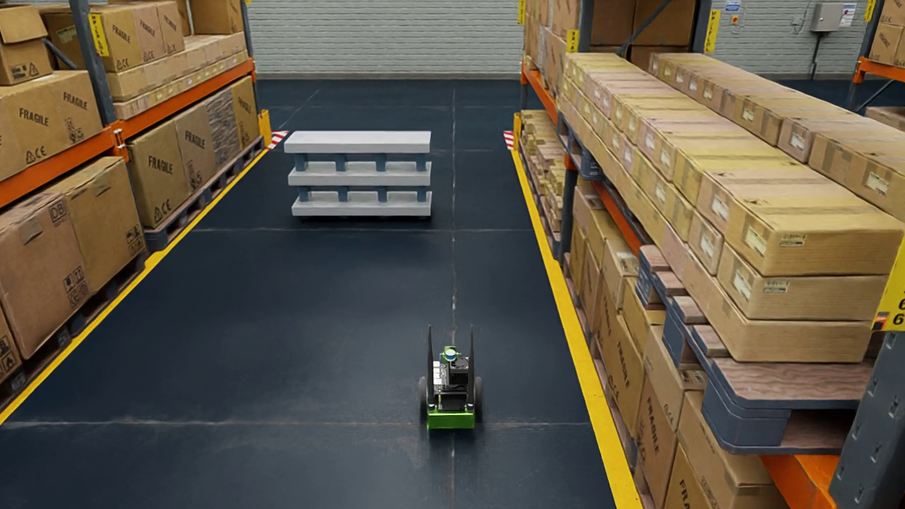

# isaacsim-jetbot-nav

阿童木机器人课题：JetBot仓储导航、视觉与激光融合、学习型局部避障。导航/系统集成负责人任权伟。

2026-10-30导航更新：[3倍模型参数与复现](docs/JETBOT_NAV_PARAMETERS_20261030.md) · [全程定位和真实停车的精度定义](docs/JETBOT_ACCURACY_DEFINITIONS_20261030.md) · [逐次回归证据](experiments/jetbot_nav_freeze_20261030/README.md)。视觉/PPO模型及场景生成由同学负责，导航只提供接口。

## 当前可复现成果（2026-10-25）

JetBot已接通原生传感器、FAST-LIVO估计里程计、AMCL、Nav2和受保护速度控制。原尺寸版本完成货架双通道与途中A/B障碍；新增3倍放大版本完成43.66m同类通道任务，直行实测约0.797m/s。PPO与视觉只留接口，未实现同学负责的模型/训练。语义导航目前只有人工地点名称到已有Nav2任务，完整视觉语义层仍为后续工作。

- [导航源码与运行说明](isaac_sim/jetbot_fastlivo/README.md)
- [3倍JetBot、速度实测及新录像](docs/JETBOT_SCALED_20261025.md)
- [原尺寸录像、时序与精度记录](docs/JETBOT_VIDEO_PRECISION_20261025.md)
- [给PPO和视觉同学的接口](docs/MODULE_INTERFACES.md) · [接口实测边界](docs/MODULE_INTERFACE_VALIDATION_20261025.md)
- [外部资源、固定后端和备份边界](assets/jetbot_resources.md)

视频在[2026-10-25 Release](https://github.com/qw-ren/isaacsim-jetbot-nav/releases/tag/jetbot-warehouse-20261025)提供，不进Git大文件；源码通过feature分支PR审阅后合入main。当前代码基于Isaac Sim4.5及现有云端依赖，不要求重装镜像。



下方为团队课题最初规划与分工，2026-10-16节点属于历史目标，不覆盖上述实测范围。


阿童木机器人课题：**基于 Isaac Sim 的 JetBot 视觉-激光融合导航与学习型局部避障**（暂定）。

先跑通 Isaac Sim + JetBot + ROS 2 + SLAM/Nav2 的目标点导航 baseline，再推进 PPO 局部避障及与传统局部规划器的对比，逐步接入视觉与激光感知融合。当前仓库为项目骨架，尚未实现各模块 Demo。

## 四个模块

| 模块 | 主要工作 | 最小 Demo |
| --- | --- | --- |
| 仿真 | Isaac Sim 场景、JetBot、相机与激光雷达、ROS 2 桥接 | 机器人在简单场景中运动并输出传感器数据 |
| 视觉感知 | 接入现成检测模型，探索视觉与激光融合 | 对一帧或视频完成目标检测并展示结果 |
| 强化学习局部避障 | 搭建训练环境、观测/动作/奖励，采用 PPO | 简单障碍场景下跑通环境交互和一次训练/推理流程 |
| 导航与系统集成 | ROS 2 接口、TF、SLAM、Nav2 与模块集成 | 简单场景中跑通建图或已知地图目标点导航 |

## 当前里程碑：2026 年 10 月 16 日前

四个模块**各至少跑通一个最小 Demo**，记录环境版本、运行步骤、截图/短视频及已知问题。阶段汇报展示可复现结果、接口约定与下一阶段计划；此阶段不要求完成完整融合系统或收敛的 PPO 策略。

## 目录

```text
docs/           项目说明、接口约定与阶段汇报
isaac_sim/      仿真脚本、传感器与场景配置
ros2_ws/src/    ROS 2 包、launch 与导航配置
perception/     视觉感知与融合
rl/             强化学习环境、训练与推理代码
experiments/    实验配置、评估脚本与小型结果摘要
assets/         必要的小型资源与资源下载说明
```

## 后续方向

完善 baseline；评估 PPO 与传统局部规划器的成功率、碰撞率、到达时间等指标；接入视觉-激光融合。**语义目标导航与简单自然语言导航仅作为按进度开展的后续扩展，不是当前必做承诺。**

协作方式见 [CONTRIBUTING.md](CONTRIBUTING.md)。大模型、数据集、训练产物和大型场景资源通过外部存储共享，在仓库中记录获取方式。

## 2026-10-29 导航交付

[JetBot A/B连续四倍速视频、实验图表/数据与汇报素材](docs/JETBOT_RELEASE_20261029.md) · [3倍模型视觉/PPO接口更新](docs/JETBOT_SCALED_MODULE_HANDOFF_20261029.md) · [LIO/LIVO同输入对比](docs/JETBOT_LIO_LIVO_COMPARISON_20261029.md)。
