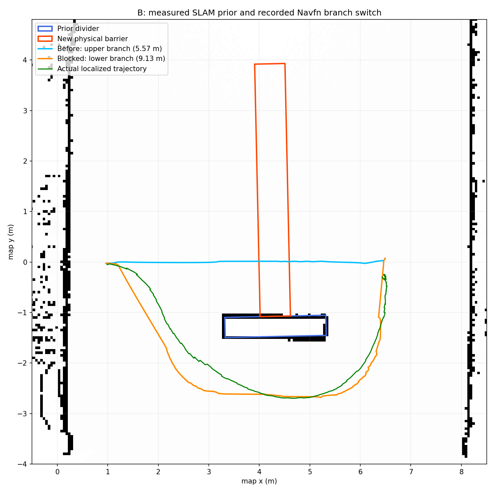

# B：仓储隔断双通路封路改道（2026-10-18）

本轮已完成真实雷达先验建图、静止封路前后原生全局规划对照，以及封路后的实际下侧行走。两轮建图各13项、规划11项、实际导航17项全部通过。尚未验证运动中突然封路、独立冷启动复现或多货架跨通道通用能力。

## 场景与边界

现有旧SLAM地图只适合开阔带，不能将放大箱体的绕行直接当作另一条通道。本轮在原仓储独立副本motion_branch_obstacles_20261018内增加可控固定隔断：中心(4.3,-1.3,.5)m、尺寸(2,.4,1)m，形成上/下两侧路线。新增封路障碍中心(4.3,1.4,.5)m、尺寸(.6,5,1)m，与隔断上侧相接。

固定隔断在建图时已存在，新增封路障碍在建图时不存在。没有用真值几何修改SLAM栅格；没有将未知格改成自由。Nav2只读取保存的先验地图和实时scan障碍层。高度裁剪静态几何、先验隔断和新障碍的AABB仅供独立保护与评估。

保留原.55m保护门槛、1.5秒恒速预测、scan前方保护、TTL、姿态限制和底层失联归零；沿用Navfn、DWB、.60m规划半径、1m膨胀及原生路径有效性BT。线速上限.8m/s、角速上限.6rad/s；转向/到点允许减速，既有巡航实测>=.6m/s检查不变。

## 两侧真实SLAM采集

prior_01从(1,0)沿上侧受保护运动6.5仿真秒，移动4.874m、稳态巡航.772852m/s，无保护锁停。首图203×475、5cm；隔断背面有未知阴影，不能直接用于下侧规划，保留该版本。

prior_02从(1,-2.7)沿下侧补采。通过SLAM Toolbox原生DeserializePoseGraph START_AT_GIVEN_POSE接续首轮图；初始scan_ground种子(1.2,-2.72,0)来自已知仿真配置和首图对齐，不是自动全局重定位。移动4.853m、巡航.776427m/s，无保护锁停。两轮各13项建图检查通过。

最终地图slam_b_prior_20261018_v2：313×489、5cm，63655自由、2013占据、87389未知。原PGM SHA256为d1b0583fac30d5d5e15b6674435560593762c1b176dea05580ced82819709f38。prepare_amcl_map.py保留原PGM和原yaml，修正导航yaml的free_thresh=.196及精确原点；与保存的实时SLAM栅格逐格差异0。

建图仍使用模拟真实odom输入，不能将结果解读为独立LIO里程计精度。正式导航停止SLAM，并关闭Bridge map→odom，仅map_server+AMCL提供地图/地图定位；AMCL使用一次已知起点初始化。

## 静止原生规划对照

plan_01在固定起点(1,0)独立启动仿真、scan、AMCL和Navfn，不启动控制器、不发送速度。首次定位因seed来源标签不符合SLAM_约定被拒；保留原文件和失败日志，修正标签后恢复，种子数值和检查规则不变。

| 实际记录 | 未封路 | 加入实体封路障碍 |
|---|---:|---:|
| ComputePathToPose状态 | SUCCEEDED | SUCCEEDED |
| 路径长度m | 5.56707 | 9.13053 |
| x4–4.6m段的y范围m | -.0230至-.0040 | -2.6971至-2.6378 |
| 距先验隔断最小中心净距m | 1.05990 | 1.03666 |
| 距新增障碍最小中心净距m | 0（穿过未来位置） | 1.53660 |

原先上侧路径被新障碍封住，Navfn改为下侧路径；先验文件和/map不变，机器人最大位移.01957m。11项检查通过。

障碍ROI包含原隔断边缘，未封路时已有32个致命格，封路后114个。离线补充核查新增82格通过，不能用“ROI有致命格”单独证明新增感知。后续check_branch_plan.py已强化为增长至少20格；原始JSON和实际执行旧源码仍保留在executed_source，未改写结果。

## 实际行走

复用通过静止检查的唯一仿真/地图定位/规划器，加入已有保护和原生NavigateToPose。开始行走前新障碍已存在；不是运动中注入障碍。

plan_01/navigation_01的17项任务检查全部通过：

- NavigateToPose SUCCEEDED（4），实际通过隔断下侧；x4–4.6m段身体y范围[-2.69251,-2.59711]m。
- 巡航.713683m/s、540样本；AMCL行走更新83次。
- 全部静态/新增几何最小中心AABB净距.634036m，距新增封路障碍至少1.387659m；无保护锁停，姿态和命令边界通过。
- 行走约19.70仿真秒、82.66墙钟秒，观察到1条全局路径。
- 先验地图文件不变，map_server/AMCL来源检查通过，解除后持续零目标速度通过。

沿用已声明的Nav2 stateful xy=.20m/yaw=.50rad规则：观测进入距目标.197625m，成功时yaw误差.495207rad。动作返回XY误差.266815m，5秒后.263496m/yaw .701357rad；严格停车精度仍未通过，信息项保留。本轮最后2秒低速静止信息项通过，不据此声称精准驻足或一般停车能力已解决。

中心AABB净距是指定高度带保守投影下的检查，不是全身扫掠体安全认证；本次单次通过也不是通用成功率。

## 证据与收尾

云端artifacts/m4_global_b_20261018，本地data/cloud_warehouse/m4_global_b_20261018。包含两轮SLAM栅格和序列化图、原始地图/元数据、静止规划NPZ、实际遥测、动作结果、日志、完整stage2源码快照、B运行副本入口和复现命令。analyze_branch.py从归档自身数据重绘branch_paths.png并核查致命格增长。

21:18实时收尾验证：tmux为空，无本轮仿真/原生导航进程残留，ROS CLI daemon未运行，云电脑仍开机；未操作电源。baseline12项、稳定work3项、107项源码云端校验通过。原暂存区未操作，未commit/push阶段二。

下一步先做独立冷启动复测，再补行进中封路触发路径失效与改道，之后做C无路径安全终止。障碍移除残留与严格驻足继续独立跟踪；FAST-LIO2/LIVO2和JetBot仍在后续计划，本轮未引入。

333项完整云证据约114MiB已取回，按cloud_files.sha256逐项通过；107项stage2源码云/本地一致。
