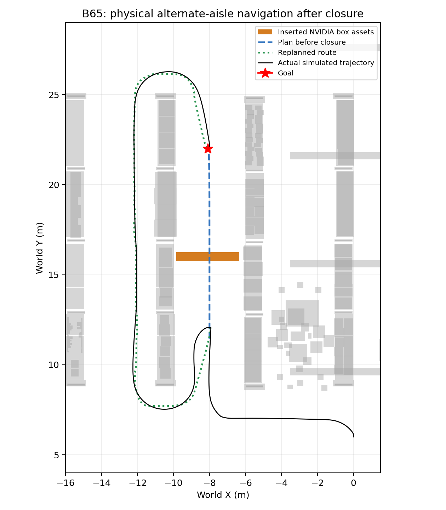
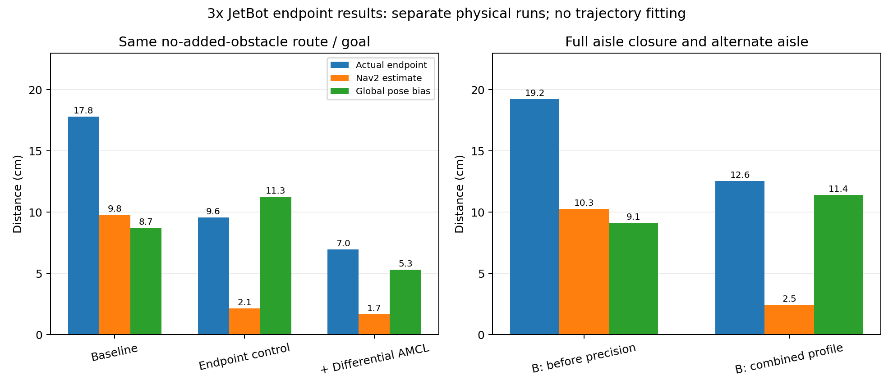

# JetBot 真实资产ABC验证与到点改进（2026-10-29）

A绕行、B封路换通道、C无路结束均取得功能通过记录；新控制/AMCL组合在B65再次完成真实封路改道。无新增障碍实际到点由17.81cm降至6.96cm；B封路由19.25cm降至12.55cm。不是所有场景达到7cm，也没有证明稳定厘米级停靠。

## 场景与现成资产

当前3倍JetBot，原生IMU、无额外噪声、0.8m/s指令上限、有头，FAST-LIVO2 + AMCL + Nav2。保留1倍及25日稳定案例，不重装Isaac/CUDA/PyTorch，不操作电源。

新增障碍引用现有Isaac4.5资产：
`/Isaac/Environments/Simple_Warehouse/Props/SM_CardBoxA_01_467.usd`，实测0.7×0.5×0.5m，保留原生CollisionAPI；无额外下载，不用新造Cube替代。布局由脚本放置，模型、材质、碰撞均复用USD。原仓库大货架仍来自NVIDIA full_warehouse。托盘、推车也已只读审计，但本次运行用纸箱，不能将其他道具称为已运行验收。

A为单箱；B/C为五箱横排，在车体通行意义上封住当前货架通道，两端残余缝小于车体宽度。没有把B画入先验地图；新增障碍由真实RTX点云/LaserScan进入实时障碍层。触发依据新鲜估计位姿及非零行进指令，不用真值触发或瞬移。

C在场景启动前用同一批资产预置远端围挡，并同步写入**受控试验**先验；行进中才关闭前方入口。目标仍为空闲单元。它不是对不可观测的未知仓库凭空宣称无路。

## ABC结果与条件

| 案例 | 实际行为/原生动作 | 路程 | 新增障碍近似车体净距 | 结果 |
|---|---|---:|---:|---|
| A57 | 同一通道内绕过行进中出现的箱子，SUCCEEDED | 43.80m | 31.45cm | 通过 |
| B62 | 原直达路径失效，退回并走相邻通道绕货架端部，SUCCEEDED | 45.71m | 189.77cm | 通过 |
| C59 | 尝试其他路线后实际无法规划，ABORTED，目标自由且全局代价图不连通，停车 | 38.70m | 163.27cm | 通过预期无路测试，不是到达 |
| B65 | 改进终点/AMCL组合下再次真实封路换通道，SUCCEEDED | 45.30m | 186.77cm | 组合回归通过 |

B62/B65均核对：封路前计划穿过障碍区域、封路后计划绕开、实际轨迹跨越障碍所在Y时位于另一货架通道、地图原文件不被动态障碍改写、目标仍可达。不是只看规划线或在原通道侧边挤过去。C原生planner日志明确failed to create plan / failed to generate a valid path，不是超时或控制器无进展冒充无路；全局GetCostmap终态证实目标单元0但不连通。C是逐步观测/探索后判无路，不是入口一关就立即知道全局无路。

上述通过案例ROS六项传感器/TF/里程计接口检查均通过，truth_subscribed=false、零额外控制发布者。净距为USD资产AABB与0.34m车体包围圆的离线近似，不是完整3D扫掠证明。

A57/C59是早期0.40m规划包络的通过记录；B62和精度组合采用后述0.65m规划包络。最终精度组合回归了B65，没有把早期A/C写成在最终全部参数下独立复测。详细CASE/参数及原始证据均保留。



## 过程中修复与失败保留

- B58改道实际发生并到目标附近，但终点要求掉头时SimpleProgressChecker仅按平移判断，Failed to make progress，native6，完整B未通过。
- B60把终点朝向设为替代通道自然到达方向，仍在起点正常旋转时因10秒没有平移被停止，未触发障碍，不能算障碍测试。后置队列正确停止。
- 现有ROS包已自带PoseProgressChecker，使用其角度进展阈值0.10rad，原平移阈值/10秒静止超时不变；无安装/重编译。这是计入真实转向，不是取消卡住检测。
- B61修正转向进展后能行进和改道，但绕货架拐角时预测净距0.3773m，触发原0.40m保护，保持锁停，仍失败。
- B62将局部代价图从3×3扩至5×5m、规划包络改0.65m、膨胀半径1.0m，为预测/扫描时延和转角留余量。真实车体尺寸/0.34m包围圆、0.40m保护阈值、1.5s预测、速度上限与失联停车均未降低。额外规划余量有通行空间代价，不宣称适合任意窄通道。

## 到点误差分解与实跑

以下是不同实跑回合，不是同输入重放或统计重复。前三行同一无新增障碍路线/目标，后两行为相同B封路/目标。以真实终态与目标的距离衡量到点，不用轨迹拟合或真值修正在线定位。

| 条件 | 真实到点 | Nav2认为离目标 | 同时刻全局定位误差 | 同时刻LIVO相对声明起点误差 |
|---|---:|---:|---:|---:|
| 56：原始无新增障碍基线 | 17.81cm | 9.80cm | 8.74cm | 1.66cm |
| 63：终点控制调整，AMCL不变 | 9.56cm | 2.14cm | 11.26cm | 2.95cm |
| 64：再改差速AMCL及运动噪声 | 6.96cm | 1.67cm | 5.30cm | 3.01cm |
| 62：B封路，旧终点参数 | 19.25cm | 10.26cm | 9.13cm | 1.57cm |
| 65：B封路，改进组合回归 | 12.55cm | 2.46cm | 11.41cm | 3.53cm |

全局误差取同一末次反馈时刻，真实到点取最终稳定位置（与该反馈时刻差极小）；LIVO采用声明起点平移[0,6]、航向0，不做全轨迹拟合。不同距离是向量关系，不应简单作标量加法。

63：保持原AMCL，XY容差0.10→0.03m，yaw容差0.30→0.12rad，持续重查XY、线速度采样15→25、末端减速；同时沿用B已验证的PoseProgressChecker/规划余量。因此不能声称相对56只改了一个数值。64相对63只改变AMCL运动模型为DifferentialMotionModel以及alpha1..5=.001（原全向模型/.005），不改LIVO、传感器、控制或目标。

**原因判断**：原终点容差约10cm，与AMCL参与形成的map全局位置偏差共同造成约18cm误差。LIVO误差明显小于全局结果，不能把18cm归咎于LIVO本身。这里是AMCL正常连续定位输出的偏差，没有运行未知初始位姿的global_localization重定位试验，不能称“全局重定位动作失败”。

收紧控制有效；运动模型/噪声调整在无新增障碍回合降低了全局偏差，但B65仍有11.41cm全局偏差（甚至高于B62的9.13cm），不能称AMCL已全面优化。当前先验是5cm栅格的保守碰撞AABB开发地图，不是精细实测激光地图；地图几何/高度投影、扫描运动补偿、滤波模型和随机粒子均可能影响匹配。后续要继续压低真实误差，应先诊断地图/激光匹配，而非无限缩小到达容差或按真值补偏移。原生扫描仅做gyro yaw补偿，未补平移，这也是已有精度边界。



## 运行入口与模块边界

现有manage_jetbot.sh继续管理唯一tmux仿真，始终使用新ID：

```bash
bash /home/admin/jetbot-warehouse/code/manage_jetbot.sh status
bash /home/admin/jetbot-warehouse/code/manage_jetbot.sh start UNIQUE_ID 300 nav2 stationary /home/admin/jetbot-warehouse/code/warehouse_precision_amcl_safe_20261029.json
```

这是当前无新增障碍精度候选；封路组合配置warehouse_asset_B_precision_20261029.json。原始默认/1倍配置保留，不把其参数悄悄替换成3倍车。PPO/视觉接口和唯一速度门/TF所有者不改，无训练、检测器或完整语义导航新增。

## 收尾与备份

A57/C59/B62/63/64的runner及全部子进程exit0，速度归零；B65功能、传感器检查、停车均通过，但固定FAST-LIVO后端在SIGINT收尾出现rclcpp上下文失效并exit-6（已知43中也出现过）。B65 runner仍返回0，不能据此称全部子进程正常退出。该收尾问题未重建后端解决，日志保留。

完整本轮归档：jetbot_assets_abc_precision_20261029_01.tar.gz，142,674,897B，SHA256 `dc5a69dd8ff029412a92a020d8ea3fbf5bf29264b4265b88ac6f26fdc9b859d4`。1919文件（1918逐文件SHA+清单）本地全部核验，含57–65成功/失败、56基线、冻结源码/参数、参考轨迹、代价地图、接口/控制/定位日志、截图；不含完整Isaac镜像、资产库或权重。受控本地目录data/cloud_warehouse/jetbot_abc_20261029；云端abc_20261029。

本轮未commit/push，独立工作树team_export/jetbot-abc-20261029，原复杂暂存区未动，无电源操作。运行结束后的无遗留进程检查另存REST_STATE.json。
