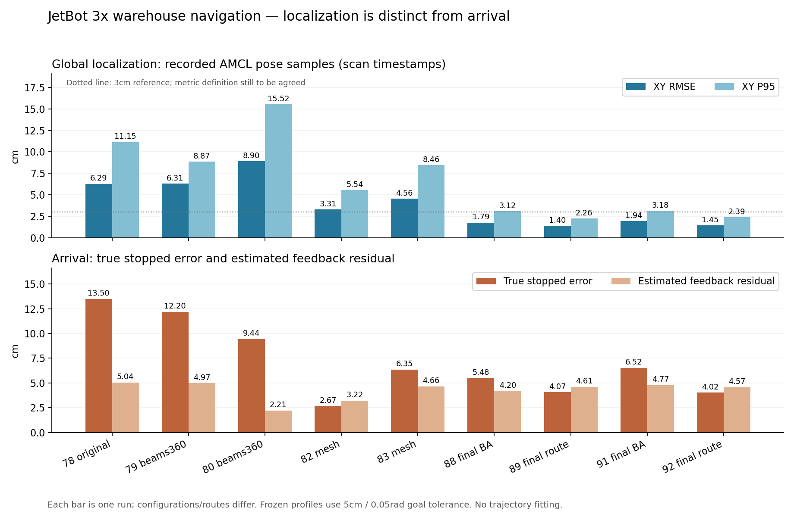

# 3倍 JetBot 导航与定位参数，2026-10-30

状态：冻结为`jetbot_3x_nav_v1_20261030`，通过两次无新增障碍长路线、两次既有B→A和一次C无路处理。仅限已测仓储仿真，不保证每时刻3cm。任权伟负责导航、定位和集成；场景种子、物体清单、视觉模型和PPO训练不在本轮交付范围，不用于真机。源码/配置摘要及验证清单见 [FROZEN_PROFILE.json](../experiments/jetbot_nav_freeze_20261030/FROZEN_PROFILE.json)。

## 评价口径与结论

“定位3cm、航向1–2°”优先解释为全程全局定位目标；导师未指定RMSE、P95或最大值，不能自行认定。全局定位误差、真实停车误差、GoalChecker容差分别报告，定义见 [精度口径](JETBOT_ACCURACY_DEFINITIONS_20261030.md)。没有全轨迹拟合、真值闭环或轮式里程计替代LIVO。

历史64：AMCL航向RMSE .25°，真实停车航向误差6.44°；因此停车朝向偏差不能直接当定位航向精度。历史位置误差也确实存在：原始/amcl_pose的全程误差达到厘米级，并非仅仅误解终点指标。

本轮改善针对定位输入链和控制器模型适配，不能简化成“AMCL算法有问题”。先验几何、测量模型和估计速度共同影响结果，单次低终点误差不足以选参数。

## 冻结参数及边界

入口：`isaac_sim/jetbot_fastlivo/warehouse_diffnav_20261030.json`；固定既有B→A回归和C无路处理分别用同目录 `warehouse_diffnav_BA_20261030.json`、`warehouse_diffnav_C_20261030.json`。三份配置使用相同导航参数。

| 项目 | 参数或行为 |
|---|---|
| 估计链 | 原生IMU加速度/角速度 + FAST-LIVO2 + 原生AMCL；AMCL唯一发布map→odom，估计适配器唯一发布odom→chassis |
| AMCL运动模型 | DifferentialMotionModel，alpha1–5均 .001；max_beams 90，update_min_d .05m、update_min_a .1rad |
| AMCL测量模型 | likelihood_field_prob，sigma_hit .05m，do_beamskip true；distance .5m、threshold .3、error_threshold .9 |
| 定位地图 | 2cm栅格的静态可见CAD Mesh表面投影，独立/localization_map，仅AMCL使用 |
| 规划地图 | 原5cm保守CAD先验，仍使用/map；动态障碍不写入先验 |
| 差速速度适配 | 显式启用differential_planar：只将导航odom twist的vy/vz投影为0；LIVO位姿、TF、前向速度、原生IMU角速度保持原值；日志保留完整原始速度 |
| 速度有效性保护 | 投影前的完整原始速度仍检查有限值和3m/s异常上限；不以投影隐藏原始异常 |
| DWB停车速度分类 | trans_stopped_velocity .10m/s；这是分类阈值，不是最低行驶速度，也不是到点容差 |
| 到达判据 | XY .05m、yaw .05rad（2.86°）、stateful false；FollowPath XY同为 .05m |
| DWB | vx_samples 25、vtheta_samples 20、sim_time 1.5s、RotateToGoal.slowing_factor 10；局部窗口5×5m |
| 速度与采样 | 最大 .8m/s、.6rad/s；min_vel_x/min_speed_xy/min_speed_theta均为0，无新增最低速度或最低角速度限制；离散采样分辨率仍存在 |
| 停滞检查 | PoseProgressChecker，位移 .10m/角度 .10rad、10s预算，保持既有保护 |
| 规划包络 | robot_radius .65m、footprint_padding .01m、inflation_radius 1m；不等于实体尺寸或硬性净距 |
| 实体与门控 | 保守实体圆约 .34m；scan点到预测中心轨迹阈值约 .40m，预测1.5s；按实体圆解释，额外间距约6cm |

输入超时 .35wall秒、scan .8wall秒、clock/odom .5wall秒、sim age .3秒及失联锁停不放宽；不自动恢复、不自动切Nav2。原始轮关节上限不修改。无有效IMU orientation不等于不使用IMU。

导师提到的“膨胀约5cm”不能直接拿来覆盖Nav2 inflation_radius：膨胀半径描述代价衰减范围，实体包络、代价梯度和安全门阈值的含义不同，见 [Nav2膨胀层说明](https://docs.nav2.org/jazzy/configuration_and_development/configuration_guide/core_servers/costmap_2d/costmap_plugins/inflation/) 和 [本工程Humble实现](https://api.nav2.org/nav2-humble/html/inflation__layer_8cpp_source.html)。本版保持已验证的避障保护；没有用缩小规划圆或安全距离来换精度。

## 为什么增加这两项适配

原先验为保守CAD包围盒，适合规划但部分轮廓不等于激光可见表面。独立定位图从原USD静态可见Mesh按扫描高度裁剪后投影，不改USD、不读取真值轨迹。声明地面z=0，底盘标称高度从CAD轮支撑推导约 .100865m；扫描相对底盘 .03–.40m，对应世界高度约 .130865–.500865m。613个Mesh、112952个裁剪三角面、1852×3791格。2cm栅格不是2cm精度保证。

更准确地图仍需合适的测量模型：默认likelihood_field/σ=.2在既有BA回归84中出现大偏差，而且首次超过20cm发生在B生成之前，不能说初始误差由B造成。切换原生prob模型、beam skipping和σ=.05后继续回归。beam skipping仅影响AMCL定位评分，避障costmap和安全门仍接收完整scan。

87已穿过两处障碍后，最终约16.5cm处因无进展失败。末段真实速度中位数约 .00029m/s，但原生估计平面速度约 .179m/s，近似转换到车体坐标后主要为侧向分量；DWB的差速配置vy及侧向加减速度均为0，其预测却会带入输入的侧向速度。[Humble轨迹生成源码](https://api.nav2.org/nav2-humble/html/standard__traj__generator_8cpp_source.html)确认从当前速度初始化预测，逐轴用加减速度逼近命令；[RotateToGoal源码](https://api.nav2.org/nav2-humble/html/rotate__to__goal_8cpp_source.html)使用输入XY速度判定停车阶段。当前显式差速平面投影用于消除这项模型不一致。两项改动联合验证，不能从88单次通过确定各自独立贡献。并未证明LIVO后端估计速度问题已根治，坡道、显著侧滑及三维运动不在本轮验证范围。

默认1倍配置和native twist模式保留；新定位图只允许3倍配置显式启用，启动前核对基础场景和规划图SHA，避免换场景后静默复用旧定位图。C的声明静态fixture仍在该基础核对之后加入USD和规划先验。此适配没有加入轮速或真值测量，也没有改估计位姿来提高离线评分。

启动另修复每case生成YAML中`map_server.yaml_filename`的绑定，避免原硬编码参数使CLI覆盖未生效；74因此不是有效的2cm图实验，不回写历史结果。显式启用独立定位图时才增加第二个原生map_server和生命周期节点，不增加TF发布者。`bt_navigator/get_state`只读查询在原50秒预算内允许重试、取消过期future；不延长运动或失联保护预算，85的`change_state`启动失败仍未根治。

## 回归证据（持续补齐）

| case / 配置 | 原生结果与收尾 | AMCL XY RMSE / P95 | 真实停车XY / yaw |
|---|---|---:|---:|
|78 原图、5cm/.05rad到达|成功、全子进程0|6.29 / 11.15cm|13.50cm / 3.02°|
|79 原图、360束|成功、全子进程0|6.31 / 8.87cm|12.20cm / .55°|
|80 360束重复|成功、全子进程0|8.90 / 15.52cm|9.44cm / 2.30°|
|82 表面图、原测量模型|成功、全子进程0|3.31 / 5.54cm|2.67cm / 2.34°|
|83 同82重复|成功、全子进程0|4.56 / 8.46cm|6.35cm / 3.10°|
|88 本版参数，B→A|成功、全子进程0、独立几何审计通过|1.79 / 3.12cm|5.48cm / 2.69°|
|89 同参数，无新增障碍长路线|成功、全子进程0|1.40 / 2.26cm|4.07cm / 2.83°|
|91 同参数，B→A独立重复|成功、全子进程0、独立几何审计通过|1.94 / 3.18cm|6.52cm / 2.76°|
|92 同参数，无新增障碍长路线重复|成功、全子进程0|1.45 / 2.39cm|4.02cm / 2.78°|

88真实行程47.29m，B生成后实际跨到相邻通道，随后A单箱绕行；圆形实体近似对资产AABB的最小额外间距约 .453m，仅为离线几何近似，不是接触力碰撞测量。安全门无fault、退出归零、六项输入检查通过。AMCL航向RMSE .119°、P95 .218°；估计停车残差4.20cm，与真实5.48cm分开。

91重复真实行程45.84m，同样实际B改道后A绕行，A处圆形实体对AABB近似额外间距 .494m；全套审计通过。AMCL航向RMSE .124°、P95 .226°。估计停车残差4.77cm，真实6.52cm；不能把差值或真实停车误差直接当AMCL全程精度。

导航实际使用的全局位姿（.05s统一时间网格）位置RMSE：88=2.08cm、89=1.61cm、91=2.33cm、92=1.69cm；行程加权RMSE分别2.03cm、1.62cm、2.22cm、1.69cm。89/92的AMCL航向RMSE均约 .095°、P95 .187/.195°。AMCL样本统计和连续导航位姿统计均保留，不用其中一个替代另一个。

四次完整到达真实停车4.02–6.52cm，AMCL样本RMSE1.40–1.94cm，导航组合位姿RMSE1.61–2.33cm，均为逐次结果范围，不是多场景统计置信区间。固定相同导航参数；88之后恢复投影前完整原始速度保护，88原始数据全部满足该保护（见`TWIST88.json`）；91/92增加基础几何SHA检查，92仅补充接口说明文本。实际最终运行源码与待发布源码逐文件匹配见`RUNTIME92_SOURCE_MATCH.json`。没有通过更换位姿来源、收紧到达容差或降低保护取得这些结果。

90 C无路处理通过：原生状态6、全部进程0、输入检查通过、安全门无fault且退出归零。终态costmap中当前位置和目标格代价均为0，但分属不连通区域；原生planner NoPath后ABORTED，无超时或拒绝。此项是预期无路停车，不是到达成功，也不把距目标8.28m当“到点精度”。证据`C90_ASSET_TRIAL_AUDIT.json`。

C终止前定位也单独保存：AMCL样本XY RMSE2.13cm、P953.82cm、max7.56cm；导航全局位姿均匀时间RMSE3.80cm、P957.72cm、max16.69cm，行程加权RMSE2.23cm。说明不能把成功长路线的约1–2cm RMSE扩展成每时刻误差上限，也不能只看AMCL发布样本忽略导航实际使用的组合位姿。此不同且被中途终止的路线不与完整长路线合并排名；证据`LOCALIZATION90_NOPATH.json`。

AMCL表格均为约5Hz探针所记录、按消息自身scan时间戳去重的发布样本统计，可能漏更新，并非所有发布或均匀时间统计；同时保存导航全局位姿按 .05s时间网格、按行程加权和运动期的误差。不同路线不能作为严格单因素对照；两条路线各仅两次，不证明广泛或每时刻3cm。



失败和未完成试验不删除：81输入超时锁停；84/86无路失败且定位退化；85初始化服务响应丢失、未运动；87末端无进展。它们不是当前最终配置的重复成功统计，也不能从整个研发批次中隐去。74地图加载不符、75初始化失败、76后端退出-6、77过小容差主动中止等早期证据亦保留。

## 安装与复现（云端、纯仿真）

保留原Isaac/CUDA/PyTorch及固定FAST-LIVO后端。先用现有工程部署方式准备依赖；以下命令只针对已具备该运行环境的云端，`CODE`指隔离代码目录。

```bash
python3 "$CODE/install_localization_prior.py" --output /home/admin/jetbot-warehouse/map_candidates/localization_mesh_002_20261030
bash "$CODE/manage_jetbot.sh" status
bash "$CODE/manage_jetbot.sh" start UNIQUE_NEW_ID 140 nav2 stationary "$CODE/warehouse_diffnav_20261030.json"
```

不可重用case目录，不并行启动。地图包26,836B，SHA256 `bb37a565945bdb13810182d53b32e67050ca1d539f46bcb9f41dde38600ac7f7`；安装器校验包和各文件SHA，拒绝覆盖不同的已有地图。地图构建阶段的`preflight_passed:false`声明表示未认证为规划先验；此图仅作定位图，不能替换保守规划图。

完成后用Isaac自带Python运行离线评分：

```bash
/home/admin/isaacsim/python.sh "$CODE/summarize_freeze_trial.py" --case "$CASE" --output NEW_VALIDATION.json
/home/admin/isaacsim/python.sh "$CODE/audit_showcase.py" --case "$BA_CASE" --output NEW_AUDIT_DIRECTORY
/home/admin/isaacsim/python.sh "$CODE/audit_asset_trial.py" --case "$C_CASE"
```

基础汇总不能替代ABC几何审计。C必须证明目标栅格空闲、通路不连通、原生NoPath/ABORTED并停车，不能称到达成功。证据包含冻结源码和输入摘要，原始truth仅离线评分。

精选原始证据在 [2026-10-30预发布](https://github.com/qw-ren/isaacsim-jetbot-nav/releases/tag/jetbot-nav-baseline-20261030) 提供；代码仍经PR #6审查，未合入main。`navigation_selected_20261030_01.tar.gz`为100,778,033B，SHA256 `1d0e1786a2ecc366d831e211d380800fcd92d714f82c34df59c6e2bd2e543384`，覆盖78–92共15例成功与失败，2038个原始文件逐一核验。另保留72–77的`precision_selected_20261030_01.tar.gz`（36,239,452B，SHA256 `ac5a6f8264216cc5f32b056078105e65a1e4131f236a6c80292c347ed38edd01`）。包内排除USD/完整资产、RGB和原始点云，保留源码、输入/控制/真值离线轨迹、scan和选编costmap；完整云端原始case仍保留。下载后按`SHA256SUMS`及包内逐文件清单校验，不把大日志加入Git。

## 尚未覆盖

冻结覆盖BA两次、无新增障碍长路线两次及C一次，五次均满足各自预期原生状态、全部进程0、输入检查和安全门无fault/归零。C仍有较大全局瞬时偏差，少量重复不能承诺每时刻3cm或广泛成功率。未证明任意A/B排列均稳定，旧67布局本轮71未复现，已按用户要求停止扩展诊断。深度+录像高负载、历史rclcpp退出竞态及启动服务响应丢失未根治；本批长路线无深度/录像，不能作为高负载稳定性证明。未验证绑架恢复、多种场景统计、视觉/PPO实模型联调或完整语义导航。
